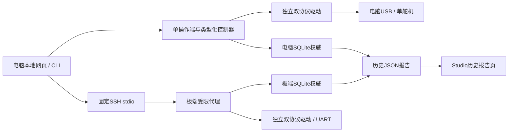
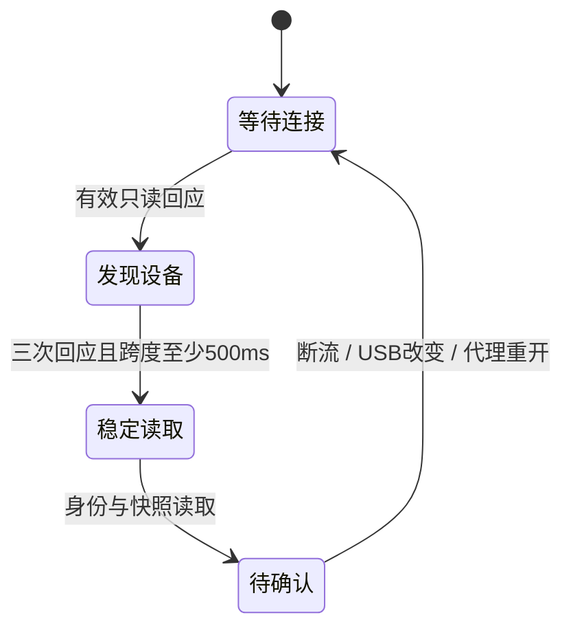

# 双协议舵机工作台：统一设计与实现边界

组件0.1.0，Tools0.6.0；本轮实现用户修订的“换机不断流程，上电自动接续检查”。真实板端、USB适配器、供电、中位及动作全部NOT_RUN。

## 模块和权威

`profiles.py`固定型号寄存器、预设和布局；`protocol.py`独立有界编解码；`transport.py`单连接与独占保护；`engine.py`配置/恢复状态；`actions.py`可选中位、台架和参数回退；`store.py`完整同步事务；`service.py`同一CLI/HTTP/代理控制器；`remote.py`固定SSH消息通道；`reports.py`纯历史格式校验。Studio只导入reports模块，不创建Controller或串口驱动。

USB电脑、板端代理各自保存权威，不以浏览器缓存判定成功。标准库SQLite采用WAL+synchronous=FULL；内核锁保证同一状态目录一个后台；另有每执行端一个总线锁与浏览器30秒操作租约。端口POSIX独占；Linux板端额外检查robotd服务、手工进程和所有可见FD，失败即阻断。无自动服务控制、UNO Q Bridge或daemon改动。

## 连接与任务是两套状态

配置事实独立保存：待配置→备份与预览→配置中→本次读回通过→待整组掉电复核→已完成。断线不清除备份/已发包意图/历史通过项，进行中的任务转“中断待核对”，绝不直接转成功。

已完成ID重新出现回到原关节；实体没有可靠唯一序列号时仍须核对实物标签。未观察到供电断开、同型号固件等都不能证明“同一只”或“已断电”。

## 事务与中断

每个请求绑定 `revision + connection_epoch + plan_hash + job_id`；计划包含预设摘要、旧读数、源/目标ID与速率。幂等ID相同请求返回原作业，不重新发包；同ID不同请求拒绝。后台恢复增加代次、清空预览；旧队列和旧连接回复不可用于新连接。

每个写步骤：写前读回检查→FULL同步落盘intent→发一次指令→保存sent→同连接读回→verified。写入应答丢失时可读回，但不重发。ID/波特率最后修改，按新地址读回。未知结果保留旧/新定位信息，重新读取后明确确认，仅处理剩余差异。

HD1910解锁与重新锁定独立记录，换机提示要求最终型号、扭矩关闭与锁状态核对通过。中断后的relock是显式恢复操作，绝非重连副作用。Reset Mid独立0x0B意图，位置2048/偏移验证不通过时不可宣称成功；动作断开取消，无法确认卸力则未知。

SSH EOF冻结未发包步骤，取消任务；旧reader不能清除新SSH请求。只重连登记主机，固定协议握手核对0.1.0代理；不自动升级代理。USB优先VID/PID/序列号，macOS过滤同设备tty/cu重复项，无序列号重连或歧义必须重新选。

## 资源、节奏和接口

一个发现线程、一个串口句柄；等待退避0.5/1/2秒，超过60秒降到5秒。先探测上次/当前/出厂地址及必要速率，完整扫描明确触发。稳定后读参数，不自动写。实时已知设备约3秒到待确认是硬件待测目标；模拟状态机跨度仅验证逻辑，不等于适配器达标。

`/api/servo-workbench/v1/`提供批次创建/打开、状态、端口、接管、预览/确认、暂停/恢复、立即检测/扫描、重新核对、整组复核、只读检查、报告和事件。`stream`为1Hz、有界120秒、最多2个事件订阅；页面默认轻量轮询。写接口同源Origin+CSRF，localhost Host白名单；没有原始寄存器写API。SSH使用相同白名单，代理配置限制型号和固定串口。

模拟与真实执行隔离；所有导入报告强制historical/live=false/hardware_acceptance=false，不能改实时身份、控制许可或校正回执。JSON≤2MiB，报告含快照及最近最多50作业，按1.8MB预算限制，每作业最多保留末500步骤/300采样并标注原始数量；事件窗口前200条，所有省略明确标注。完整历史在权威SQLite，大型诊断请停后台后备份整个状态目录。

## 保留与后续拓展

三个daemon版本仅提供XL330预设来源，双协议驱动独立；**能初始化HD1910不等于原生robotd已支持Feetech运动**。新增型号必须独立寄存器、身份、单位、写白名单、模拟和厂商契约，未知型号只显示不套写。设备型号/布局/预设变化要新建批次；不原地改旧计划。

Reset Mid后标记坐标代次和校正复审；不写入现有机器人软件零位/IMU配置。未提供远程浏览器串口、自动固件升级、自动电源控制、广播初始化或整组动作。
