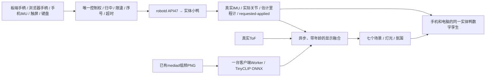
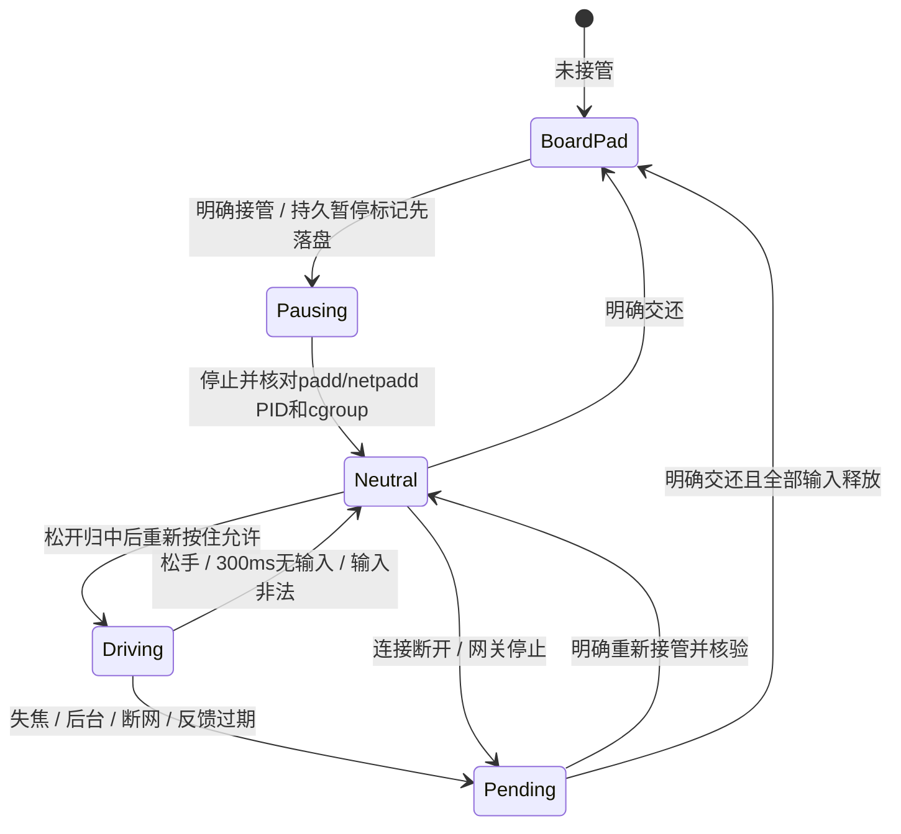

# Tools 0.6.0 统一设计：可遥控实体鸭、真实反馈数字孪生、环境语义融合

状态：2026-11-01 已实现软件候选，等待 PR 与现场验收。本文取代此前分散的 Mobile、控制与 3D 规划。实机升级、服务交接、配对、运动及资源验收均 **NOT_RUN**，不能据本地测试宣布可直接开动力。

## 一张图理解三条链路

控制意图、daemon报告的应用值、实际观测分别显示。连续接口没有逐帧动作完成回执，`submitted=true, executed=false` 只说明提交。实体鸭不动时，实体模式的虚拟鸭也不能通过指令积分假装移动。主题不能进入控制决策。

## 输入与交接契约

首版真实控制限定已固定的 **0.18.3 / API47** 官方或 calv3 构建，实际进程 SHA、模型关节顺序与运行校正回执必须通过检查。calv3 是本项目第三版原生校正补丁构建标识，并非官方版本号；固定来源见 `deploy/manual-upgrade/inputs.json`。旧 0.16.3、0.17.9 可读取能提供的反馈和使用原校正工具，但不开放 Studio 真实控制。

板端蓝牙/USB手柄沿用 padd/netpadd；本机手柄先由手机/电脑操作系统连接，再经 Gamepad API 读取。网页不是系统蓝牙配对接口。本机标准映射默认轴 0/1/2、LB允许，非标准设备可以保存轴/按钮映射。手机姿态要求可信 HTTPS、用户授权和中立校准；竖横屏变化、姿态样本超过500ms时清空输入。触屏、键盘、手机IMU、本机手柄共用网关，同一时间只选择一个来源。

- 20Hz上限、最新输入覆盖；序号递增；初始限速 vx±0.1m/s、vy±0.05m/s、yaw±0.4rad/s，有限数值检查。
- 300ms无新按住输入时发停车；状态超过600ms、健康超过3秒、IMU未ready/连续旧块≥25、fallen/picked_up/limp或未知，拒绝移动。`--no-policy` 不能网页解除。
- 输入切换先停车再归中；键盘重复按键不能在失焦后自动恢复。语义、渲染、WebSocket心跳均不刷新移动计时。
- 暂停标记 `/var/lib/microduck-studio-handoff/phone.pending` 原子落盘并fsync，先于服务停止；两个原生手柄服务只加独立 ConditionPathExists 保护，不替换 ExecStart。中断不自动恢复服务。`return.intent` 记录交还过程，中断后需明确恢复暂停或重新交还。
- 检查完整有效启动参数、条件、启停钩子与服务联动；不认识的配置拒绝接管。只恢复原来活跃的一个来源；不会顺带启动另一个。
- 原生 daemon 有自身 deadman（固定源码默认500ms）；网关300ms停车不能保证在整个系统断电、进程被杀或daemon卡死时执行。不得把网页停车当硬件急停，也不能把500ms默认值冒充任意现场配置的已核验值。无直接 robotctl/其他客户端同时写入是现场接管条件，daemon的last-writer接口本身没有全系统租约。
- 普通监控服务不写机器人配置；启用/停用policy、动作、声音、模型/skill/按键配置与配对均需明确操作、先停车、参数白名单及读回。启动Studio不会初始化、卸力、重启舵机或恢复手柄。

## 手机/桌面与数字孪生

统一橙黑主题，五页：总览、控制、监控、Policy、手柄；另保留原校正页面入口。手机底部导航、44px触控目标、折叠异常详情与关节卡片。原校正业务代码不变，网关注入独立移动CSS和关节字段显示标签；原Web未启动或版本不匹配时明确报错，不自动启动服务。

实际四元数为 trunk→world 的 w/x/y/z；统一 x前/y左/z上 → Three.js 的 (-y,z,-x)。身体使用真实四元数，头嘴和腿使用实际15关节角的简化可爱骨架；此模型不是精密机械CAD。里程计提供相对位置估计与最多256点轨迹，不叠加odom yaw。5Hz反馈、约200ms缓冲、客户端30FPS目标，SLERP姿态插值，不外推。状态断流、姿态失效时保持最后可信显示并标示冻结；daemon epoch/时间戳回退清空缓冲及轨迹。健康过期不宣称姿态有效。没有位移就保持位置，没有电流就显示未知。

七场景共用几何、鸭子和材质，只保留当前装饰：橙光庭院（花点/灯光）、星夜码头（栈桥/水面配色）、萤火森林（树木/萤火点）、糖果小镇（积木屋）、极光雪原（雪色/极光饰片）、微缩工坊（桌台/工具饰件）、太空营地（基地/小星球，纯手动主题）。颜色和灯光渐变；同一位姿、轨迹和世界坐标不随主题重置。装饰不是实际障碍。

独立演练替换整个数据源，只做标记明确的运动学示例；不调用机器人、助手、原Web、蓝牙或真实Camera，不证明动力学和policy。设备/目标切换停车清空输入并重新接管。

## 环境估计

| 来源 | 默认节奏 | 可以说明 | 不能说明 |
|---|---|---|---|
| IMU / 实际关节 | 5Hz | 姿态、运动可靠性上下文 | 没有位移时不能推算实际移动 |
| ToF | 客户端2Hz | 有效目标、近远氛围 | 不重建空间、不避障、不把无目标当安全 |
| Camera | 全局约10秒一次，负载大延至60秒 | 粗类别、图像质量 | 与姿态不是严格同步的空间测量 |
| 融合 | 新证据后异步更新 | 各来源有效性和降级原因 | 不自动修复、不产生动作 |

ToF仅核对8×8：status5/9有效、255无目标，其他无效；以源时间戳与姿态相差≤150ms配对，用实际传感器几何、重力和可用高度排除地面；过近<0.1m不用作分类，至少4个可信非地面分区，以水平P25距离<0.6m为近、>0.8m为远，连续不同样本保持600ms。缺姿态/高度/几何、被拿起、陈旧>1.5秒时保留原始网格并解释未知。阈值为工程初值，非安全标准。

语义 Worker 使用固定 TinyCLIP ViT-8M/16 Text-3M q8 ONNX，revision `9463a9c508a344c837ffefe9d724f3827bf2dc79`，模型 SHA256 `10921310ddef06557ec1598d1260470a0a4db53f70ffe0deb60b946dcad6d27a`。模型约24MB，启用后才加载；依赖 Three.js0.170.0、Transformers.js3.7.2和对应ORT均打包在局域网，无CDN/云推理。模型和资源许可及逐文件哈希随包提供；[上游模型卡](https://huggingface.co/onnx-community/TinyCLIP-ViT-8M-16-Text-3M-YFCC15M-ONNX)仅支持模型接入说明，不替代本项目验收。

标签固定 workspace/home/greenery/urban/waterside/snow/unknown。分数是七类之间相对支持度，并非校准概率。Worker检查过暗/过曝/低纹理/疑似模糊；IMU明显晃动时网关暂缓新取帧。质量差、支持<0.65、候选差<0.15、旧帧不自动切主题。至少两张不同快照一致、主题保持至少30秒。结果带frame_id、model_sha和年龄；分析权一次只给一个客户端，15秒未续约可由其他端接管。未验证结果只用于显示。客户端恶意改结果也不获得运动权限。

相机只请求已有mediad `/frame`，其内部会按需取帧并PNG编码。Studio全局单在途、3MiB/1920px上限、10–60秒节流，与通过网关访问的旧相机预览共享缓存。绕过Studio直接打开旧Web/mediad的客户端不在此共享范围，现场资源验收需关闭或单独统计。普通服务无/proc跨用户读取权限时，由受限root助手核对固定程序PID/SHA及原生media.sock hello；不假设官方mediad存在自定义identity.json。不会重新打开摄像设备、改采集参数或在板端推理。

## 接口、隔离与资源

`/api/studio/v1/` 提供 pair/status/stream/model/query/action/jobs/diagnostics/logs/camera/resources；真实反馈 `source=live`，模拟 `source=simulation`，环境为 `estimated=true`。未认证只能看登录壳和静态UI；数据/资产/模型需一次性配对登录。默认可信局域网HTTP（0.0.0.0:8790）、可选HTTPS；同源Host/Origin、HttpOnly/SameSite cookie、CSRF写校验、WS同源，登录码5分钟一次性、会话8小时；不要暴露公网。

一条共享robot状态订阅5Hz、一条共享ToF、一条按需生命周期内的pad.input和1Hz健康轮询；两端共享缓存和结果，不逐浏览器启动原生客户端。pad输入仅保留最新附着/轴键帧，不保留高频IMU批次。没有活跃可见实体显示端3秒后释放订阅。原始每帧262KiB读取上限、字段裁剪、最新值覆盖、2MiB遥测缓存预算；慢端限速/超时断开，不累积历史队列。相机缓存独立3MiB。

独立 systemd slice 共享限制：CPUQuota=20%（一逻辑核）、CPU/IO低权重、MemoryHigh=64MiB/Max=96MiB。普通服务 `microduck-studio` 用户，受限助手只提供固定的交接、BlueZ扫描/连接和进程身份只读核验；禁止任意shell、任意RPC、设备寄存器访问。诊断只给建议，不自动执行。

| 验收项目 | 门槛/状态 |
|---|---|
| 客户端3D | 30FPS目标、低性能15FPS、WebGL失败二维；≤1.5万三角形、≤45次绘制 |
| Studio相机关闭 | 单客户端平均≤一核5%，Studio+助手常态RSS目标≤64MiB：板端NOT_RUN |
| 同数据量3D相对2D | 板端CPU增量≤一核2%，RSS增量≤8MiB：板端NOT_RUN |
| Camera/多客户端 | 统计Studio+助手+mediad额外CPU/RSS、首次模型加载、loop下降：NOT_RUN |
| 手机模型内存/耗电 | 另行实测；过慢停视觉，不迁回板端：NOT_RUN |

## 诊断与交付验收

版本化异常手册包含原文、来源、版本、年龄、证据、排查顺序、只读命令、预期、处理和恢复验证。覆盖DXL缺失/错误、IMU、循环下降、跟随偏差、温压、policy、手柄、ToF、Camera、身份/权限、控制与资源；没有单独DXL采样计数时显示daemon控制/总线循环频率，不把5Hz网页订阅冒充DXL速率。细粒度舵机诊断继续使用原健康插件与维护报告。

本地测试包括重复/回退时间戳、缺失/非法数值、超时、交接失败/恢复意图、安装中断/文件漂移、HTTP/WS认证、原Web CSRF代理、白名单和演练隔离、旧236项回归、客户端投影/语义质量门槛、真实浏览器七场景与响应式检查。六张独立公共照片只作语义冒烟，不足以验收实机场景准确率；真实手柄/手机权限、实际身体/里程计对齐、失联物理停车、机身朝向和资源限额实际生效均须现场测试。

交付见 [使用与部署指南](studio-0.6.0-guide.zh-CN.md)、[验收登记](studio-0.6.0-validation.zh-CN.md)、[总部署登记](deployment-register.zh-CN.md)。独立 `studio.sh setup/configure/start/status/pair/stop/hand-back/recover/rollback/demo`，默认预览，真实变更另加明确执行参数。本地交付含源运行包、离线ARM64 wheels、浏览器资产和模型、逐文件哈希、截图与测试证据。旧0.5.0管理器/原生程序/核心校正代码保持冻结，不迁移正在进行的旧管理会话。

2026-11-03网络修订：按用户要求默认HTTP，保留认证/CSRF和明确功能开关；明文局域网访问不替代安全上下文能力。旧运行包经外置受控启动器和Journal适配，无需原位覆盖；network-rollback只回退网络。板端关闭，本次LAN部署和性能NOT_RUN。
